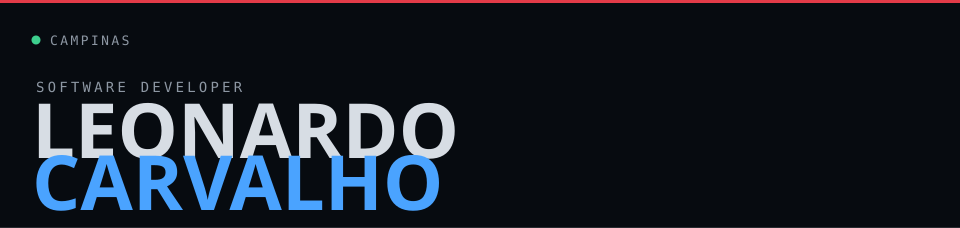

<!--
GitHub profile. Create the public repository lccas/lccas and
commit README.md, banner.svg, and leonardo.jpg at the root.
-->

I have been building web systems and applications since 2019, with five years at Codee.Tech. I look after the API, the database, and the interface in Node.js, TypeScript, and React, and I stay with the system after it goes into production.

**Core** · Node.js, TypeScript, React  
**Data** · PostgreSQL, Prisma, Docker  
**AI** · Chatbots, LLMs, machine learning, RAG, and MCPs  
**Language** · Portuguese, English C1

## 01 Work

**2021 — now · Codee.Tech, Campinas**  
Systems in production, from design through maintenance. Since October 2021 I have built and maintained systems for several clients, including an ophthalmology product. I am responsible for the REST and GraphQL API, the React interface, PostgreSQL with Prisma, and the Docker environment.

I also build chatbots with LLMs. A message comes in, the flow checks the client's system, and it sends the reply back. When a person is needed, the conversation goes to an attendant. That support also has an app.

**2021 · 5 months · GPR Sistemas, Campinas**  
I built the backend in Python, with Flask and PostgreSQL, and authentication with JWT. In React, I worked on components, state, and routes with the team.

**2019 — 2021 · Casbrasil Conexão Farma, Campinas**  
I started as a Django intern at the end of 2018. From 2019 to 2021 I built an e-commerce site and a partnerships system, and I handled production maintenance, with Git, Docker, and Scrum.

## 02 Projects

**ZooNo** · zoonosis detection, app and map  
In the Expo app, someone photographs the animal or the insect. GPT-4o identifies the species, rates the risk, and suggests how to handle it. The record goes out with the location and shows up on the dashboard map in real time.  
Expo · Node.js · Prisma · PostgreSQL · GPT-4o

**Quíron Kimonos** · Quíron Sport Wear, orders off the spreadsheet  
The workshop tracked orders and users in Excel. I built the web application that took over that flow and is in production: NestJS, Prisma, PostgreSQL, and Next.js, with authentication and unit tests.

## 03 Practice

Languages · TypeScript, JavaScript, Node.js, Python  
Interfaces · React, Next.js, Expo  
Services · NestJS, Django, Flask, GraphQL, Hasura  
Data · Prisma, PostgreSQL, MySQL  
Environment · Git, Docker, Linux, unit tests  
AI · Chatbots, LLMs, machine learning, RAG, and MCPs

## 04 Education

**2024 — 2026** · Analysis and Systems Development, technologist degree from Universidade Paulista. Completed.  
**2016 — 2018** · Computer Systems, technical course at Colégio Politécnico Bento Quirino.

## 05 Courses

08/2022 · React: Function Components, Alura  
07/2022 · REST with Node.js, Express, and MySQL, Alura  
09/2021 · Docker: containers in practice, Alura  
08/2021 · JavaScript for the web, Alura  
03/2021 · React: how the library works, Alura  
02/2021 · Python 3: introduction and further into the language, Alura  
03/2020 · HTML5 and CSS3, Udemy  
11/2018 · Python 3, Udemy

## 06 Contact

[leonardobcarv@outlook.com](mailto:leonardobcarv@outlook.com) · [github.com/lccas](https://github.com/lccas) · [LinkedIn](https://linkedin.com/in/leonardocarvalho133)
